  

  
  
  
  

## 👋 About me

I'm a **Data Scientist** with nearly **4 years of tech experience**, coming from **software engineering** and **cybersecurity** and now focused on **applied AI**. At **Decathlon**, I build GenAI features from the ground up, from the LLM/RAG pipeline to cloud infrastructure, monitoring and security.

- 🔭 **Now:** Data Scientist (work-study) at **Decathlon**, working on LLMs, RAG, Google Cloud and AI security
- 🎓 **Studying:** Machine Learning Engineer program, **Liora × Mines Paris – PSL** (2025 – 2027)
- 🛡️ **Background:** Engineering degree in **Cybersecurity**, INSA Centre-Val de Loire
- 🧮 **Roots:** CPGE MP\* (maths, physics, computer science), which is where my taste for algorithms comes from
- 🌍 **Based in** Lille, France  
- 🌐 **Languages** French · English · Wolof

## 🚀 Highlights

<table>
  <tr>
    <td align="center" width="25%">
      <h3>~300</h3>
      users on the <b>LLM / RAG conversational agent</b> I build and improve at Decathlon
    </td>
    <td align="center" width="25%">
      <h3>98%</h3>
      faster testing of the agent's answers with an automated <b>LLM-as-a-Judge</b> evaluation
    </td>
    <td align="center" width="25%">
      <h3>🛡️ SAML</h3>
      Project lead on patching a <b>critical vulnerability</b>, from design to delivery, at QUALNET
    </td>
    <td align="center" width="25%">
      <h3>⚡ Real-time</h3>
      <b>alerting</b> for Cloud Run services that catches issues <b>before users notice them</b>
    </td>
  </tr>
</table>

## 🛠️ Tech stack

<table>
  <tr>
    <td><b>AI &amp; ML</b></td>
    <td>
      
      
      
      
      
      
      
    </td>
  </tr>
  <tr>
    <td><b>Cloud &amp; Data</b></td>
    <td>
      
      
      
      
      
      
      
    </td>
  </tr>
  <tr>
    <td><b>Languages &amp; Web</b></td>
    <td>
      
      
      
      
    </td>
  </tr>
  <tr>
    <td><b>DevOps &amp; Quality</b></td>
    <td>
      
      
      
      
      
      
    </td>
  </tr>
  <tr>
    <td><b>Security</b></td>
    <td>
      
      
      
    </td>
  </tr>
</table>

## 🧪 Projects

<!-- Tip: if these projects have a public repo, turn each title into a link, e.g. [Mask detection](https://github.com/Wolfidy7/<repo>) -->

| Project | What I did | Highlights |
|---|---|---|
| 😷 **Mask detection**  2024 · Engineering school | Trained an object-recognition model to detect people wearing surgical masks | Precision **76%** · Recall **65%** · F1 **70%** |
| 🧭 **Maze-solving AI**  2022 · CPGE | Built intelligent agents that find their way through a maze | Compared **BFS, UCS and A\*** with several heuristics |

## 🌱 Outside of code

🏀 Basketball · 🏃‍♂️ Sprinting · 🚴 Cycling · 📸 Photography: see my shots on [Instagram](https://www.instagram.com/wolfidy7/)

  <i>Open to conversations about LLMs, RAG, AI security and building reliable ML systems. Feel free to reach out!</i>

  

